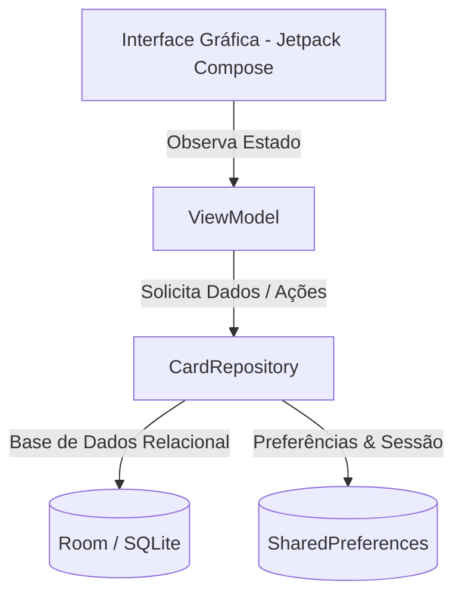

# CardFolio

  
  
  
  
  

---

## 📌 Informações Académicas
**Henrique Lindeza Veríssimo 53717**
- **Instituição:** Universidade da Beira Interior (UBI)
- **Departamento:** Departamento de Informática (DI)
- **Unidade Curricular:** Programação para Dispositivos Móveis (PDM)
- **Projeto:** Gestor de Coleção de Cartas (*CardFolio*)

---

## 1. Breve Descrição da Aplicação
O **CardFolio** é uma aplicação móvel para Android que funciona como um gestor digital de cartas colecionáveis (como cartas de futebol, Pokémon, TCG, entre outras). Permite aos colecionadores e comerciantes organizar a sua coleção pessoal ou de revenda, acompanhar o valor investido, saber quanto gastaram e lucraram, e registar vendas e compras de forma simples e organizada.

---

## 2. Arquitetura da Aplicação (MVVM)
A aplicação segue o padrão arquitetural **MVVM (*Model-View-ViewModel*)** recomendado pelo Android, garantindo a separação de preocupações e reatividade com *Kotlin Flows*:

---

## 3. Funcionalidades Principais
- **Autenticação de Utilizador:** Cada utilizador tem a sua conta protegida com palavra-passe encriptada, mantendo a sua coleção privada.
- **Gestão de Cartas:** 
  - Adicionar novas cartas indicando nome, categoria, coleção, custo de compra, valor estimado, estado e propósito (coleção pessoal ou revenda).
  - Editar ou eliminar cartas existentes.
- **Controlo de Vendas e Revenda:**
  - Definir preço de anúncio e colocar cartas à venda.
  - Registar uma venda concluída (indicando o preço final e a data de venda).
  - **Reverter Venda:** Se necessário, reverter uma venda concluída para colocar a carta novamente no inventário ativo.
- **Gestão de Catálogo:** Adicionar e gerir categorias, coleções, jogadores e clubes personalizados.
- **Estatísticas e Finanças:** Visualizar gráficos e resumos automáticos com o investimento total, valor de mercado e lucro obtido.
- **Definições Personalizadas:** Ativar o modo noturno ou o modo de privacidade (ocultar valores monetários), com gravação automática.

---

## 4. Tecnologia de Armazenamento
Para guardar toda a informação no telemóvel, a aplicação utiliza:
- **Base de Dados Room (SQLite):** Guarda de forma estruturada e segura todas as contas de utilizador, cartas, categorias, jogadores e clubes. Garante que os dados não se perdem ao fechar a aplicação e atualiza os ecrãs automaticamente em tempo real.
- **SharedPreferences:** Utilizado para memorizar pequenas preferências do utilizador, como manter a sessão iniciada (para não ter de fazer login sempre que abre a app), guardar a escolha do modo noturno e a preferência de privacidade de valores.

---

## 5. Estrutura dos Dados
A informação está organizada em tabelas relacionadas na base de dados:
- **Utilizadores (`UserEntity`):** Guarda os dados de acesso de cada conta.
- **Cartas (`CardEntity`):** Guarda os dados individuais de cada carta (preço de custo, estado, propósito, etc.).
- **Catálogo (`CategoryEntity`, `CollectionEntity`, `PlayerEntity`, `ClubEntity`):** Tabelas auxiliares que organizam as cartas por categorias, edições, jogadores e clubes.

---

## 6. Decisões de Implementação
- **Interface Intuitiva (Jetpack Compose):** Escolha de uma tecnologia moderna de componentes visuais em Jetpack Compose para criar um design limpo, moderno e adaptável (Material 3).
- **Segurança nas Vendas:** Implementação de regras de negócio lógicas (por exemplo, uma carta já vendida fica bloqueada de ser enviada diretamente para a coleção pessoal, exigindo primeiro que a venda seja revertida).
- **Atualização em Tempo Real:** Sempre que o utilizador adiciona ou apaga uma carta, a interface atualiza-se de imediato sem necessidade de recarregar ecrãs manualmente.

---

## 7. Dificuldades Encontradas e Superadas
- **Sincronização de Dados:** Garantir que as alterações feitas nas cartas atualizassem instantaneamente os gráficos financeiros e as listas. Foi resolvido com o uso de fluxos reativos (`Flow`).
- **Prevenção de Erros de Apagamento:** Evitar que o utilizador apagasse uma categoria ou coleção que ainda estivesse a ser utilizada por cartas existentes.
- **Persistência de Preferências:** Garantir que definições como o modo escuro se mantivessem ativas após reiniciar a aplicação.

---

## 8. Funcionalidades Adicionais
- **Reversão de Venda:** Funcionalidade que permite "desfazer" uma venda e repor a carta no estado normal de inventário.
- **Modo Privacidade:** Um botão rápido para esconder valores monetários caso esteja a mostrar a coleção a outras pessoas.
- **Dados de Demonstração (Seed):** A aplicação preenche automaticamente alguns dados de exemplo no primeiro arranque para facilitar a demonstração imediata.

---

## 9. Como Abrir, Compilar e Testar a Aplicação

### Como Abrir o Projeto
1. Abra o **Android Studio**.
2. Clique em **File > Open** e selecione a pasta do projeto `CardFolio-PDM-`.
3. Aguarde alguns segundos enquanto o Android Studio prepara o projeto (barra de progresso no fundo).

### Como Compilar
1. Ligue um telemóvel Android ao computador (com a depuração USB ativada) ou abra um Emulador virtual no Android Studio (clicando em *Device Manager*).
2. Clique no botão verde **Run** ▶️ na barra superior (ou prima `Shift + F10`).

### Como Testar a Aplicação (Guia de Utilização)
Quando a aplicação abrir no dispositivo, pode testar todas as funcionalidades seguindo estes passos:
1. **Ecrã de Login / Registo:**
   - Pode criar uma nova conta clicando em registar, ou utilizar os dados de demonstração.
2. **Adicionar uma Carta:**
   - No ecrã principal (Coleção), clique no botão para adicionar uma nova carta.
   - Preencha o nome, selecione a categoria, insira o preço de custo e o valor estimado, escolha o propósito (*Coleção Pessoal* ou *Revenda*) e guarde.
3. **Ver Detalhes e Gerir Estados:**
   - Clique em cima de qualquer carta na lista para abrir os detalhes.
   - A partir daí pode **Editar**, **Definir Preço e Anunciar**, ou **Registar Venda Concluída**.
4. **Testar a Reversão de Venda:**
   - Numa carta que esteja marcada como "Vendida", abra os detalhes e clique no botão **"Reverter Venda"** para a colocar novamente no inventário ativo.
5. **Testar o Modo Noturno e Privacidade:**
   - Vá ao ecrã de **Perfil / Definições**, ative o *Modo Noturno* ou *Ocultar Valores Monetários*, feche a aplicação completamente e volte a abri-la para verificar que as preferências se mantêm guardadas.
